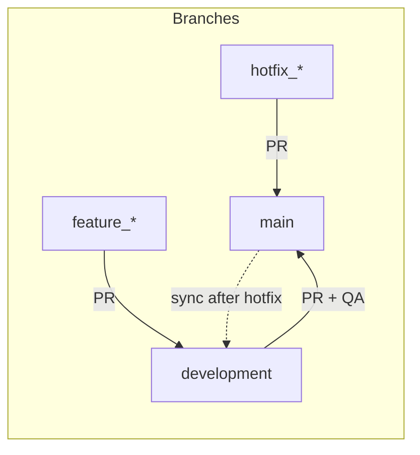
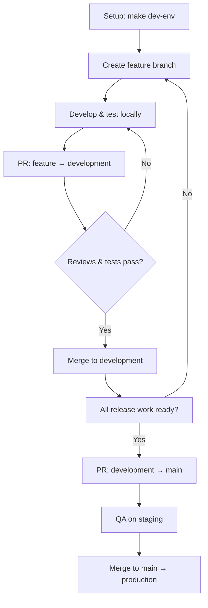
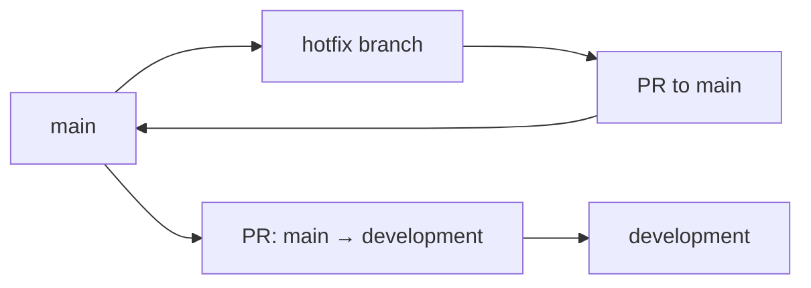

# Development Process — Quick Start

A concise guide for new developers. For full details (GitHub Project setup, issue hierarchy, etc.), see [development_process.md](development_process.md).

---

## At a glance

| You want to… | Do this |
|--------------|--------|
| **Start working** | `make dev-env` → create feature branch from `development` → code & test locally |
| **Ship a feature** | PR: `feature_branch` → `development` (1 human + 1 AI review, tests pass) |
| **Release to production** | PR: `development` → `main` → QA on staging → merge (deploys to prod) |
| **Fix a critical bug now** | Hotfix: branch from `main` → PR to `main` → **then** merge `main` back into `development` |

---

## Branch structure

| Branch | Purpose |
|--------|--------|
| **main** | Production. No direct pushes — use PRs only. |
| **development** | Integration branch for the next release. |
| **feature_*** | New work. Branch from `main` or `development`. |
| **hotfix_*** | Urgent production fixes. Branch from `main`; see [Hotfix](#hotfix-process) below. |

---

## Development workflow (standard path)

### Steps (condensed)

1. **Setup** — `make dev-env`
2. **Work** — Create feature branch from `development`, develop, run tests & evals locally.
3. **Review** — Open PR to `development` (use PR template). Requires **1 human + 1 AI** review; CI must pass.
4. **Release** — When the release is ready: PR `development` → `main`. QA on staging, then merge to deploy to production.
5. **After merge** — Update `CHANGELOG.md`; optionally update `report-out.qmd`.

> **Tip:** Use GitHub Projects for backlog and sprint planning. See [development_process.md](development_process.md) and `gh_project_setup.md`.

---

## Hotfix process

For **critical** bugs that must go to production immediately (bypass normal dev → main flow).

### Quick steps

| Step | Action |
|------|--------|
| 1 | From `main`: `git checkout -b hotfix/description-of-fix` |
| 2 | Fix, add tests, run tests & evals locally |
| 3 | Open PR: **hotfix → main** (1 human + 1 AI review; QA on staging) |
| 4 | Merge to `main` → production deploy; update `CHANGELOG.md` |
| 5 | **Critical:** Open PR **main → development** and merge so the hotfix is not lost |

> **Warning:** Always merge `main` back into `development` after a hotfix. Hotfixes should be rare; prefer the standard workflow when possible.

---

## GitHub Project (optional)

<strong>Backlog tags & status flow</strong>

- **Backlog tags:** Feature, Bug, Task, Epic, Initiative  
- **Status:** Backlog → Ready → In Progress → In Review → Complete  
- **Priority:** P0 (1–2 days) → P1 (3–5 days) → P2 (~2 weeks) → P3 (1–2 months)

<strong>Key tabs</strong>

| Tab | Use |
|-----|-----|
| Backlog | New issues; tag by type (Feature/Bug/Task) |
| Sprint Planning | Assign to sprints and people |
| Daily Management | Kanban by person; use "blocked" tag |
| QA Review | Items "In Review" |
| My Tasks | Your assigned work by priority |

---

## Quick reference

- **First time:** Read [development_process.md](development_process.md) for GitHub Project setup, issue hierarchy, and workflow details.
- **Environment:** `make dev-env`
- **PRs to development:** 1 human + 1 AI review; tests must pass.
- **PRs to main:** QA on staging first; then merge to deploy to production.
- **After hotfix:** Merge `main` → `development`.
